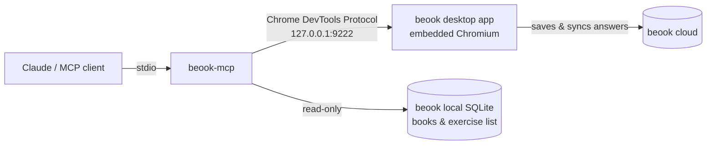

# beook-mcp

**Let Claude (or any MCP client) work through the exercises in your [beook](https://beook.ch) ebooks.**

beook is the ebook app many Swiss schools use for textbooks and workbooks (hep, Klett, and other
publishers). `beook-mcp` connects an AI assistant to the beook desktop app on your computer. It can
browse your books, open an exercise, read it, and type answers into the same fields you would use.
beook then saves and syncs the answers itself.

> [!NOTE]
> This is an unofficial community project. It is not affiliated with ionesoft GmbH or any
> publisher. It works with content you already have access to in beook and does not get around
> licenses or encryption. Answers come from the AI, so they can be wrong. Use it to learn, and
> follow your school's rules.

## Features

- 📚 **Browse**: list your books, chapters and exercises, including which ones are already done
- 🧭 **Navigate**: open any exercise by reference, or step to the next or previous one
- 👀 **Read**: get the exercise as clean text, with every answer field marked inline
- ✍️ **Answer**: fill in the answer types beook uses most:
  - free text and cloze gaps (also inside tables)
  - single and multiple choice
  - dropdowns
  - drag & drop into gaps from an answer pool
  - putting items in the right order
- 🖼️ **Visual exercises**: screenshots plus click/drag for drawing and image tasks
- 🛡️ **Safe writes**: answers are only written to the exact exercise you name. If beook shows a
  different exercise, nothing is changed.

## How it works



beook shows its pages in a built-in Chromium. When beook starts with
`-Dchromium.remote_debugging_port=9222`, `beook-mcp` can connect to those pages and:

1. read the exercise exactly as beook shows it,
2. set answers the same way the app does when you type or drag,
3. trigger beook's own save, so everything syncs normally.

It reads book structure and exercise references from beook's local database, in read-only mode.
The question text itself always comes from the running app.

## Example

```text
> beook_read_exercise

Book: ABC | Exercise: EX_02_A4 | Aufgaben A4 — Budget
Type: match

Um sich einen Überblick über die ⟦F1 drop max 1 = empty⟧ und ⟦F2 drop max 2 = empty⟧
zu verschaffen, erstellt man am besten ein ⟦F3 drop max 2 = empty⟧ …

⟦answer pool: P1: "Einnahmen", P2: "Ausgaben", P3: "Budget", …⟧
```

```json
// beook_fill_answers
{
  "ref": "EX_02_A4",
  "answers": [
    { "field": "F1", "value": "Einnahmen" },
    { "field": "F2", "value": "Ausgaben" },
    { "field": "F3", "value": "Budget" }
  ]
}
```

## Requirements

- Windows with the [beook desktop app](https://beook.ch) installed and signed in
- [Node.js](https://nodejs.org) 22.13 or newer (uses the built-in `node:sqlite`)

## Installation

```bash
git clone https://github.com/MarcBlattmann/beook-mcp.git
cd beook-mcp
npm install
```

### Claude Code

```bash
claude mcp add beook --scope user -- node --no-warnings /path/to/beook-mcp/src/index.js
```

### Claude Desktop and other MCP clients

```json
{
  "mcpServers": {
    "beook": {
      "command": "node",
      "args": ["--no-warnings", "C:/path/to/beook-mcp/src/index.js"]
    }
  }
}
```

Then ask something like *"Open the first unfinished exercise in chapter 2 of my workbook and solve
it."* If beook is not running with the debug port yet, the assistant calls `beook_launch` to
restart it.

## Tools

| Tool | Description |
| --- | --- |
| `beook_status` | Is beook running and reachable, and which exercises are open |
| `beook_launch` | Start beook with the debug port (`restart: true` closes a running beook first) |
| `beook_list_books` | Books and chapters, with how many exercises are done |
| `beook_list_exercises` | Exercise references, filterable by book, chapter, and not yet done |
| `beook_open_exercise` | Open an exercise by `ref`, or go to the `next` / `previous` one |
| `beook_read_exercise` | Exercise text with inline fields `⟦F1 …⟧`, choice options `F1.2`, and answer pool `P3` |
| `beook_fill_answers` | Write answers to the exercise `ref` (see below) |
| `beook_screenshot` | Image of the whole exercise page; image pixels equal page coordinates |
| `beook_click` | Click or drag at page coordinates, for drawing and image exercises |

**Answer values by field type**

| Field | Value |
| --- | --- |
| text | the text, `\n` for line breaks |
| single choice | option label or handle (`"F2.3"`) |
| multiple choice | list of all options to tick, or `{ "field": "F2.3", "value": true }` |
| select | option text |
| drop zone | pool item text or handle (`"P4"`), a list for zones that take several, `[]` to empty |
| order | all items in the right order (texts or handles like `"F5.2"`) |

## Configuration

| Variable | Default | Purpose |
| --- | --- | --- |
| `BEOOK_EXE` | found via the Windows uninstall registry entry, else `C:\Apps\beook\beook.exe` | Path to `beook.exe` |
| `BEOOK_DEBUG_PORT` | `9222` | Chromium remote debugging port |
| `BEOOK_WORKSPACE` | `%APPDATA%\ionesoft\beook\release` | beook data folder |

To have beook *always* start with the debug port, add `-Dchromium.remote_debugging_port=9222` as the
last line of `beook.ini` in the beook install folder.

## Good to know

- **Security:** while the debug port is open, any program on your computer can control beook. It
  only listens on `127.0.0.1`. Close beook, or start it normally, when you're done.
- **"Done" markers:** beook can mark an exercise as done as soon as it has been opened and saved,
  for example an ordering task. This is beook's own behaviour.
- **Interactive widgets:** some exercises (arrows between boxes, writing on images) don't render
  fully in the desktop app. They are reported as non-fillable.
- Tested with beook 9.6 on Windows 11.

## License

[MIT](LICENSE)
